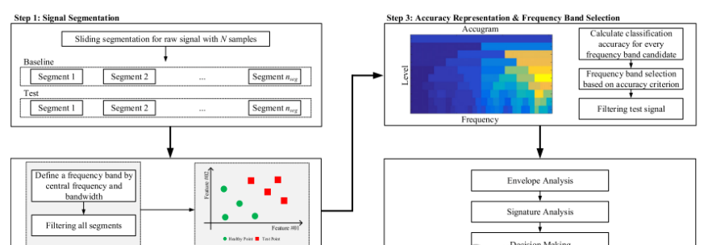
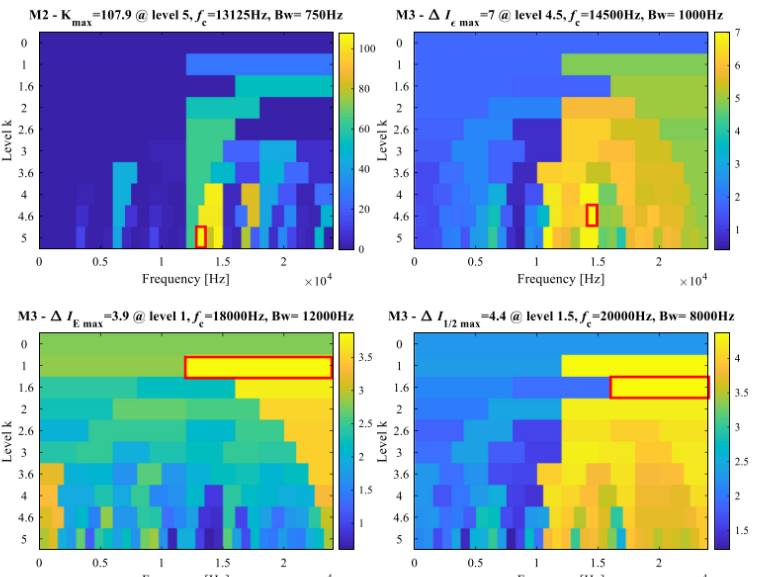

# New Method for Frequency Band Selection Based on Classification in Rotating Machinery Fault Diagnosis [with MATLAB Code]

Summary Frequency Band Selection (FBS) in rotating machinery fault diagnosis involves identifying the frequency band containing the fault transient within the full-band spectrum, thereby suppressing noise impacts from other frequency components. Pulse and cyclic stability have recently been recognized as unique characteristics of transients. Consequently, many studies have focused on developing quantitative metrics for two signatures and using them to guide FBS. However, most prior research has almost overlooked another aspect of FBS, namely health reference, which significantly affects FBS performance. To address this issue, this paper explores the importance of health references and considers it as the third critical aspect of FBS. With health references, the bands containing fault transients can be pinpointed. A new method based on classification is proposed to integrate all three aspects of FBS (impulse, cyclic stability, and health reference). Classification accuracy serves as a new metric to select the most sensitive frequency bands for rotating machinery fault diagnosis. The proposed method (created by Accugram) has been validated on benchmark tests and experimental datasets. Compared with traditional envelope analysis, peak plots, and information diagrams, results demonstrate the effectiveness and robustness of the proposed method.
Introduction: Rotating machinery fault diagnosis is a multidisciplinary interdisciplinary research topic. Vibration response has been proven to be closely related to various faults of operating rotating machinery [1]. Therefore, in the past few decades, vibration-based methods have been widely studied for fault diagnosis in rotating machinery. Among them, spectral analysis plays a core role in establishing the relationship between faults and their corresponding characteristics. The conventional process of vibration-based spectral analysis is as follows: Firstly, an original vibration signal is collected by a data acquisition system installed on the target machine; then, envelope extraction is performed on this signal; next, the extracted envelope signal undergoes Fourier transform to obtain the envelope spectrum; finally, fault features are analyzed. By observing frequencies on the envelope spectrum, it is possible to determine whether there are related faults occurring. It is worth noting that fault feature frequencies are often modulated to high frequency, such as resonant frequencies or grid frequencies. Consequently, fault diagnosis can be significantly improved if the relevant frequency band is identified and extracted from the full-band spectrum. In this paper, this problem is referred to as Band Selection (FBS). Other terms used in the literature include Information Band Selection [1] and Best Band Selection [2,3].
Essentially, the task of FBS is to identify the frequency bands that intrinsically relate to mechanical faults. In rotating machinery, early faults excite vibration transients during rotation, which provides a promising opportunity to utilize these transient characteristics for guiding FBS. Two well-recognized features of transients are pulsedness and cyclicity. Antoni first proposed a representative work on spectral kurtosis [4,5] and kurtosis plots [6], and used time kurtosis to quickly measure impulse characteristics. Later, Barszcz et al. [2] introduced the use of envelope spectrum kurtosis to measure cyclicity through the bifurcation diagram. Recently, Antoni [7] summarized evidence studies on transients and proposed a new FBS method called infogram, which considers both these characteristics simultaneously and describes them using the squared envelope negative entropy and its spectrum. The above research is a representative contribution to FBS. Additionally, improvements and extensions to kurtosis plots, kurtosis histograms, and information diagrams can be found in many other papers, such as improved kurtosis plots with robust local mean decomposition [8], improved kurtosis plots with wavelet packet transform [9], improved kurtosis plots with wavelet packet transform and power spectrum [10], adaptive spectral kurtosis [11], PAR-based kurtosis plots [12], and FBS with genetic algorithms and fast kurtosis plots [13].
From the above literature review, most previous studies actually believe that the absolute values of the indicators they propose can lead to a successful fault diagnosis FBS. However, this is not entirely correct, as the indicators may be affected by other fault-unrelated matters. In other words, the occurrence of a fault can change the absolute value of the indicators, but the absolute change in the indicators may not be caused by the fault itself. Therefore, FBS can produce misleading results and further lead to incorrect fault diagnosis decisions. Wang et al. [14] provided a promising solution by using relative values instead of absolute values in FBS. The reported SKRgram [14] used the spectral peak kurtosis between the test signal and its baseline signal in FBS. However, this idea did not attract much attention due to (1) its failure to explicitly highlight the importance of health references and (2) its lack of thorough validation and discussion on health references, where the term "health reference" refers to vibration signals collected under no fault conditions. In rotating machinery fault diagnosis, FBS should consider three aspects: pulsedness, cyclicity, and health reference. However, as far as we know, previous studies almost overlooked the third aspect, with most efforts focused on partially considering the three aspects of FBS, resulting in few studies having found comprehensive FBS that incorporates all three aspects.
To address this challenge, this paper introduces health reference as the baseline to further improve the performance of FBS for rotating machinery fault diagnosis. With health reference, the change from health reference to test signal can be more appropriately evaluated than without this information, and therefore, it can more accurately identify the true frequency bands related to mechanical faults. Following this spirit, we extensively research the importance of health reference and regard it as the third key aspect of FBS. We propose a new method that integrates all three aspects to robustly evaluate the information content of a frequency band candidate. The sensitivity scores can be used to select the most sensitive frequency band.
The key principle of our method is to evaluate the spectrum of candidate bands and identify the most sensitive one, which should contain the most critical fault evidence. Typically, a fault causes its inherently related band to differ significantly from other bands. If this frequency band is correctly identified, fault diagnosis can benefit from the lesser impact of other unrelated bands. In the proposed method, the sensitivity of a band is measured by the difference between signals under healthy and test conditions, and then classified concepts are first applied to quantify this difference. In other words, the most sensitive band typically leads to the highest classification accuracy (defined in Section 2.3), and vice versa. It is worth noting that the classification method is used to generate guidance for selecting the bands; i.e., the accuracy measure quantifies the fault information within each band and has no direct relationship with the decision on what type of fault mode occurs in rotating machinery. From the above statement, the proposed method introduces classification into band selection, which has the capability to utilize information from health status data.
\n        \n  
According to Figure 1, the proposed method includes four steps: signal segmentation (Step 1), band division and feature extraction (Step 2), accuracy representation and band selection (Step 3), and fault diagnosis (Step 4). Step 1 obtains a sufficient number of segments for classification. Step 2 generates a set of candidate bands, then calculates specific features for each candidate. Step 3 calculates the classification accuracy for each band, and selects the most sensitive band based on this accuracy standard. The selected bands are used to filter the test signal. Step 4 is the final step, where fault evidence (such as fault characteristic frequencies) is sought through square-envelope analysis, and a decision for fault diagnosis is provided. Below, we detail these four steps in detail.
2.1 Signal Splitting
The primary objective of this step is to divide a continuous original signal into multiple segments with the same time period. Next, we introduce a sliding segmentation method as one of the options for realizing this idea. Assume we have a signal x[n] collected, which has N samples (n = 1, 2, ..., N), and then define three additional parameters: Loverlap = the length of the overlap between two adjacent segments; nseg = the number of segments; and Lseg = the length of each segment. Their relationships are shown in equation (1). Once the above four parameters (N, Loverlap, nseg, and Lseg) are specified, the sliding signal segmentation can be applied to the entire signal x[n]. Subsequently, individual signals of nseg are generated for subsequent processing of the proposed method. Clearly, if the number of signal segments is limited, this step is very useful; on the other hand, if you have already segmented the single signal, this step is not necessary.
2.2 Band Splitting and Feature Extraction
2.2.1. Band division
This step aims to generate the band candidates for the following evaluation. The bands are produced by low-pass/band-pass/high-pass filters with specified center frequencies and bandwidths, which are defined in the equation. (2) (3) respectively. The input for band division is the full spectrum, i.e., from zero to half of the sampling frequency (fs). For rapid implementation, we follow the same band division as in Kurtogram [6]. The principle of the band division algorithm is described in the case of a composite filter structure based on binary and ternary decomposition. The following decomposition is based on two basic decompositions. It repeats in a pyramid manner to produce the filter band tree shown in Figure 2. We define horizontal j equal to the logarithm base 2 of the number of subparts split in the full spectrum. Taking level 1 as an example, it requires dividing the entire spectrum into quarter parts. It applies the divide-and-conquer decomposition separately to the lower and upper parts obtained from level 1. Then, X1 0 is generated from X1 0; X2 0 and X2 1 are generated from X1 1; X2 2 and X2 3 are generated from X1 1. Note that this algorithm only filters signals located within the defined decomposition layers. At level j, the center frequency fc and its associated bandwidth fc f can be calculated by the following formula:
This step primarily aims to extract transient evidence contained within the signal segment as a set of features. Feature extraction is a key preprocessing step for successful accurate representation. There are many features used in rotating machinery fault diagnosis, such as gap factors and FM4 [15]. Among them, entropy is a universal indicator of system disorder. Negentropy is a variation of entropy defined as the maximum value when energy condenses into a single pulse. To prove the proposed idea, we extract two features here: the square envelope (SE) of negative entropy and the square envelope spectrum (SES). Antonio recently proposed these two features to characterize transients [7]. They can reveal information hidden in the signal from both time domain (using the square envelope) and frequency domain (using the envelope spectrum). These two features were recently introduced to characterize transient pulsedness and cyclic stationarity. Their effectiveness has been proven in many reported papers [16—18]. Performance evaluation of other functions is not discussed within this paper. This paper mainly studies how to integrate pulsedness, cyclic stationarity, and health referenceability for band selection. Of course, more advanced functions may be developed in the future. If such higher-level functions are available, they can still be used in the proposed method. Since it does not involve contributions from this paper, we do not compare the performance of different functions.
Next, we introduce how to extract SE and SES negentropy for segments filtered to specific bands. Firstly, we introduce SE negentropy (represented by NSE) [7], which is defined in (4). It measures the single transient pulse in the signal. The transient pulses appearing in the signal result in high NSE values. Therefore, NSE is a promising indicator for distinguishing fault signals from their healthy references.
2.3. Accuracy representation and band selection
2.3.1. Accuracy representation
As mentioned at the beginning of Section 2, the proposed method assumes that monitoring data under health and test conditions should be available. Section 2.2 introduces how to generate band candidate selections and how to extract information from two types of data. This section demonstrates how to integrate their information to evaluate the sensitivity of band candidate selections. Classification techniques are used to achieve this purpose. The classification accuracy (0-1) becomes an indicator of how much rotational machinery fault diagnosis information a band contains compared to other reported methods. This is the most distinguishing feature of the proposed method compared to others. Thanks to this idea, it will show which bands are more likely to lead to successful fault diagnosis in future.
The calculation of classification accuracy is as follows. Assuming that health condition signals carry true health conditions and test signals with unknown health conditions. After applying the same sliding segment processing to each signal, NSEGSegments are generated. The NSEG segments correspond to NSEG classification samples. Band candidates can be generated through band division introduced in Section 2.2. For a band candidate, we can use the features extracted from the two datasets described earlier from the previous paragraph using the features introduced in Section 2.2. Therefore, we can generate a dataset: a 2×nseg-by-2 feature matrix and its corresponding 2×nseg-by-1 label vector. In the feature matrix, 2×nseg is the number of classification samples, and 2 is the number of extracted features. We assume that the sample numbers for both classes are the same to avoid the so-called class imbalance issue [19]. In the label vector, we use 0 and 1 to represent health condition and test condition respectively. Clearly, this is a binary classification problem because there are two classes in the label vector. K-nearest neighbors (kNN) and standard K-fold cross-validation are used to solve this binary classification problem and obtain its related classification accuracy. kNN is a nonparametric method for classification. k is the only tuning parameter, and it is set to 1 according to [20-22]. During cross-validation, K is set to 10, i.e., 90% of the samples are used for training and the remaining 10% are used for testing.
Due to the unknown true labels of test signals, we need to prove the above assumption that defines different labels from health reference. There are two scenarios for the labeling of test signals: (1) The true label is 0, indicating an error in the hypothesis; (2) The true label is 1, indicating the hypothesis is correct. In scenario 1, the training data for both labels are very similar; the classification model will definitely confuse; therefore, the test accuracy for each band candidate is very low. No fault characteristic frequency can be found in the envelope spectrum regardless of which band is chosen, leading to a diagnostic result of "No Fault" which matches the true label in this situation. In scenario 2, the classification model will be confused as a fault-unrelated band but is assumed to perform well on fault-related bands where data from two classes are very different. Therefore, the test accuracy for fault-related bands is high, while it is low for fault-unrelated bands. Based on the analysis above, we have proven that this assumption does not affect the FBS strategy and subsequent fault diagnosis decisions. Based on this effective assumption, the classification accuracy is defined by the predicted label and the labels we assume (not the true labels).
The following is a brief introduction to the band selection process. After accurately calculating the precision for all candidate bands defined in Section 2.3, we generate a classification accuracy matrix as shown in Figure 3, where Accuracyi j represents the classification accuracy of the i-th partition within the j-th level. This matrix can be interpreted as a graph like a kurtosis plot. Therefore, this paper uses Accurogram (an abbreviation for precision plot) to represent this graph. The strategy for determining the frequency with the highest information content is straightforward. The frequency with the highest information content corresponds to the highest classification accuracy. In other words, classification accuracy is the suggested metric by FBS. If there are more than one band with the same accuracy (for example, an upper limit of 100% accuracy), then there may be a tie problem. In such cases, further evaluations need to be conducted on all bands with the same accuracy. We calculate the Euclidean distance between the clustering center of health status and the clustering center of test status. The band with the larger Euclidean distance is chosen as the most sensitive band.
We discuss here the impact of classification methods on FBS performance. According to the precision criterion, this method only uses the order precision relationship between bands, not their actual precision values. Although classification methods may generate different actual accuracy values for the same band, if their order relationships remain valid, the final selection results will not change. This means that the proposed method is insensitive to classification methods. Next, we use an example to further illustrate this point. Here, we use dataset #177 (FE), which will be introduced in Section 3. We generate a program for the proposed method using 108 candidate bands. These 108 bands are evaluated by three classifiers, namely kNN, SVM, and Naive Bayes classifier. The experimental results are shown in Figure 4. According to this figure, the accuracy of all bands slightly differs among the three classifiers. The order of maximum accuracy does not change across the three classifiers. Therefore, regardless of which classifier is chosen, the best band always remains the 33rd candidate. This example shows that classifiers have no impact on the proposed method.
In the final step of band selection, choose the optimal combination of center frequency and bandwidth. Finally, use the optimal parameters to filter the test signal, preparing for subsequent fault diagnosis.
2.4 Fault Diagnosis
Many mechanical faults, such as rolling bearing and gear defects, excite vibration resonance at specific frequencies [2]. The resonant frequency and its related sidebands are what are referred to as the most sensitive bands. The previous section introduced how to identify these bands and obtain narrow-band signals. However, it is usually not sufficient to make a decision on mechanical fault diagnosis, and further steps are still needed.
Envelope analysis is one of the characteristic analysis methods in rotating machinery fault diagnosis. Its purpose is to analyze the envelope of the signal rather than the signal itself. Since the fault characteristic frequency is often modulated to a high resonant frequency, envelope analysis can be used to demodulate the fault characteristic frequency. The overall idea of signature analysis based on envelope analysis is as follows. First, use the Hilbert transform to obtain the envelope of the narrow-band signal obtained from Section 2.2. The square envelope spectrum introduced by Ho and Randal [11] can highlight the defect frequencies in the spectrum and reduce other noise components. Therefore, in the second step, apply the discrete Fourier transform to the square envelope signal to generate the square envelope spectrum. Third, perform feature analysis on the extracted square envelope signal. A common method for feature analysis is to find the fault characteristic frequency on the square envelope spectrum. If the amplitude of the fault characteristic frequency increases, it indicates that a fault related to this frequency has occurred in the system. For example, if an individual finds an increase in the important outer ring over ball frequency (BPFO), the occurrence of local faults on the outer ring of the bearing can be explained as a system failure. Of course, further feature analysis can be conducted to make more accurate diagnostic decisions. However, this goes beyond the scope of this article.

## Images

<!-- PAYMENT_BLOCK -->

## Get this dataset

- Payment link (Stripe): [Buy now](https://buy.stripe.com/3cs8yP7sY87d0vu9AB)
- Payment QR code: 

<!-- /PAYMENT_BLOCK -->
